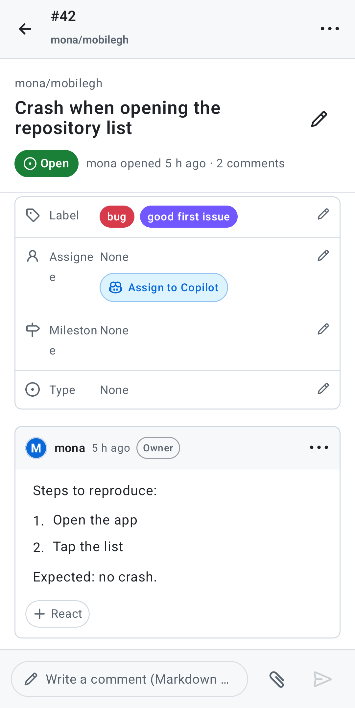
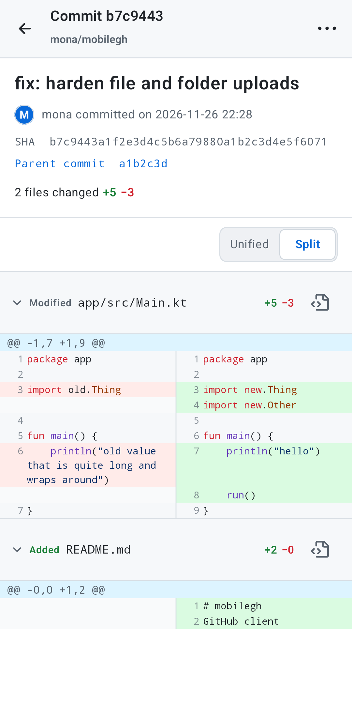
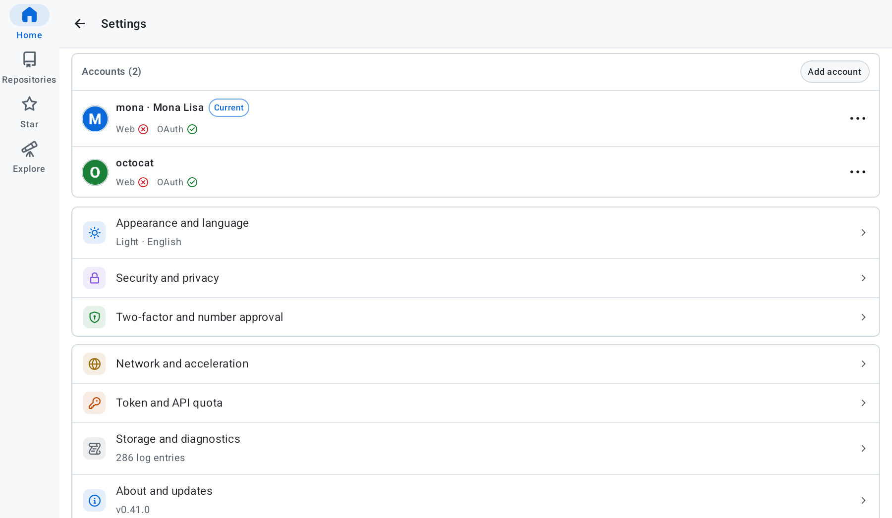

# MobileGH

MobileGH is a third-party GitHub client for Android built with Kotlin and Jetpack Compose. Browse repositories, read source code, review pull requests, handle notifications, and find Actions logs and release downloads on your phone.

[简体中文](README.md) · English · [Download the latest release](https://github.com/sheep-programmer/mobilegh/releases/latest) · [Report an issue](https://github.com/sheep-programmer/mobilegh/issues)

## Screenshots

These screenshots were captured from the v0.40.11 emulator build using fictional accounts and local fixtures.

<table>
  <tr>
    <td align="center"><br>Home</td>
    <td align="center"><br>Repository</td>
    <td align="center"><br>Issue discussion</td>
  </tr>
  <tr>
    <td align="center"><br>Split diff</td>
    <td align="center"><br>Notifications</td>
    <td align="center"><br>Actions logs</td>
  </tr>
</table>

<details>
<summary>Tablet layout and settings</summary>



</details>

## Download and sign in

Requires **Android 8.0 (API 26) or later**. See the latest Release for the v0.40.12 ARM64 APK and per-ABI checksums. [Release notes](docs/RELEASE_v0.40.12.md)

| Device | APK |
| --- | --- |
| Most Android phones and tablets | `app-arm64-v8a-release.apk` |
| Older 32-bit ARM devices | `app-armeabi-v7a-release.apk` |
| x86-64 devices or emulators | `app-x86_64-release.apk` |
| Unsure about your architecture | `app-universal-release.apk` |

Each release includes `SHA256SUMS.txt`. Sign in with GitHub authorization or a personal access token (PAT). Repository actions depend on your account permissions, granted scopes, and organization policies. [Downloads](https://github.com/sheep-programmer/mobilegh/releases/latest) · [Authentication and permissions](docs/AUTH_CAPABILITIES.md)

## Features

| Area | What you can do |
| --- | --- |
| Browse repositories | Read natively rendered READMEs, jump through the table of contents, zoom images, find source files, view blame, and sort forks by time, stars, watchers, or name. |
| Collaborate and review | Work with Issues, pull requests, and Discussions, including templates, sub-issues, Markdown drafts, inline review comments, and code suggestions. Switch between unified and split diffs and sync the viewed status of PR files with GitHub. |
| Actions and releases | Inspect jobs and steps, jump to failures, search and export logs, and dispatch or rerun workflows where permitted. Filter release assets, pause and resume downloads, and pick APKs from Actions artifact ZIPs. |
| Upload and maintain | Edit files, create branches, manage releases, and upload multiple files or folders in one commit. Git LFS handles files over GitHub’s regular file limit. |
| Organize your work | Customize Home shortcuts, pins, star lists, and favorites. Group notifications by repository, take bulk actions, and view the contribution heatmap on your profile. |
| Accounts and security | Switch between accounts, lock the app, and generate TOTP codes on the device. Number-matching approvals depend on GitHub account eligibility. |
| Read comfortably | Use the Chinese or English interface, dark mode, an optional floating bottom bar, and optional offline translation. Wide tablet windows show a navigation rail. Narrow windows use bottom tabs. |

### Offline translation

Translation is off by default. Enable it under **Settings → Appearance & language → Reading**. The app prompts you to download and install the optional component, then downloads the Chinese–English model. The switch turns on after the model passes integrity checks and a translation test in both directions. Other languages can be downloaded on demand.

Use the page’s **⋯** menu to switch between the translation and the original. Translation runs on the device, with results cached in memory for the current session. The component and downloaded language models are stored separately from the main APK.

### Downloads and updates

Open download history from the top-right corner of Home. The dash in the top-right corner of a download panel minimizes it. Closing the panel leaves tasks and files accessible from download history. When GitHub supplies a SHA-256 digest, the app verifies the file before saving it.

In-app updates use a dedicated update UI distinct from regular file downloads and automatically launch the system package installer once the update APK finishes downloading. Network settings allow configuring acceleration mirrors independently for files/images and downloads/clones.

## Build and contribute

Use JDK 17 or later and Android SDK 36. The repository contains `app` (Kotlin, Compose UI, and GitHub APIs) and `translation-plugin` (the separately installable offline translation component).

```bash
./gradlew :app:assembleDebug
./gradlew :app:testDebugUnitTest
./gradlew :app:connectedDebugAndroidTest
./gradlew :app:assembleRelease :translation-plugin:assembleRelease
```

When preparing a release, attach `translation-plugin/build/outputs/apk/release/translation-plugin-release.apk` to the same GitHub Release as `mobilegh-offline-translation.apk`. Sign both APKs with the same certificate. The component asset must have a SHA-256 digest in GitHub Release metadata. Release signing reads local `keystore.properties` or the `MOBILEGH_*` signing environment variables. With no release key configured, the build uses debug signing.

Use `tools/readme_screenshots.sh` on a dedicated emulator to regenerate the Chinese and English screenshots. Include the app version, Android version, reproduction steps, and screenshots when reporting a problem. [Feature list](docs/FEATURES.md) · [Release regression checklist](docs/RELEASE_REGRESSION.md) · [Open an issue](https://github.com/sheep-programmer/mobilegh/issues/new/choose)

## License

MobileGH’s original code is licensed under the **GNU Lesser General Public License v3.0 or later (`LGPL-3.0-or-later`)**. Redistribution of a modified version carries the license’s source and notice obligations. The LGPL’s additional permissions and conditions apply when linking with other code. [LGPL text](LICENSE) · [Underlying GPL v3 terms](COPYING)

Third-party code, dependencies, and assets retain their own licenses or terms, including Google ML Kit in the optional translation component. [Bundled web assets and third-party notices](app/src/main/assets/web/THIRD_PARTY_LICENSES.txt)
