<div align="center">

# MobileGH

**A third-party GitHub client for Android: light, fast, true to GitHub's design language, and filling in what the official app lacks on phones.**

[简体中文](README.md) · English

</div>

## Why use it

Things the official GitHub app does not show or do on a phone, MobileGH does:

- **Contribution heatmap**: the full yearly graph plus active days, best day and streaks, which the official mobile app does not show
- **Repositories you joined**: including repositories you were invited to collaborate on, not only the ones you created
- **Traffic insights**: views / clones line charts; tap or long-press to read the exact value of any day
- **Side-by-side diffs**: commits, branch comparisons and PR file changes can be viewed old-left / new-right, or switched back to a unified view
- **Actions logs**: read job logs with warning highlights, trigger `workflow_dispatch`, re-run and cancel from your phone
- **Large uploads**: pick files or folders on the phone and upload them as a single commit; files over 100 MiB automatically go through Git LFS
- **English and Chinese UI**: switch any time in Settings; Simplified Chinese is the default

## Screenshots

All screenshots are generated with a fictional test account (`mona`, `octocat`, `hubot`) and local fake data; they contain no real account information. See [Development and testing](#development-and-testing) to regenerate them.

<table>
  <tr>
    <td align="center">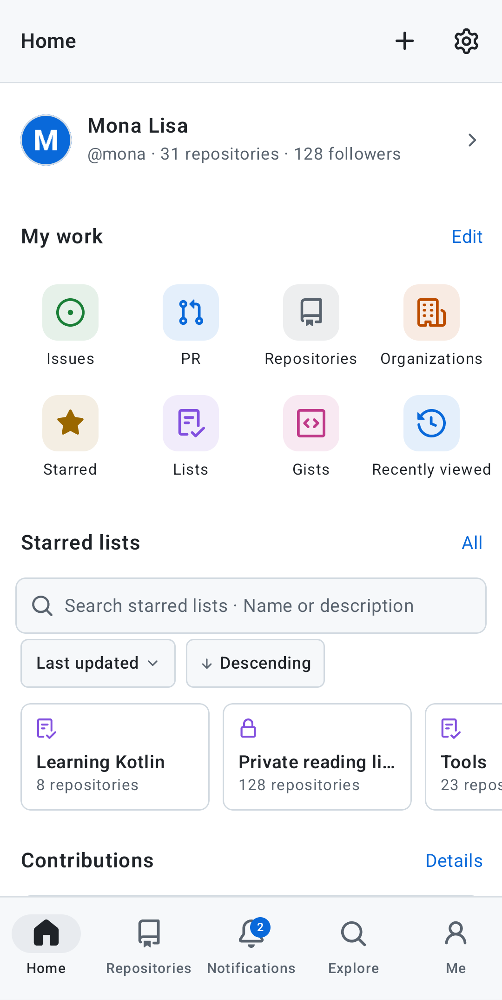<br><sub>Home: shortcuts, heatmap, activity</sub></td>
    <td align="center">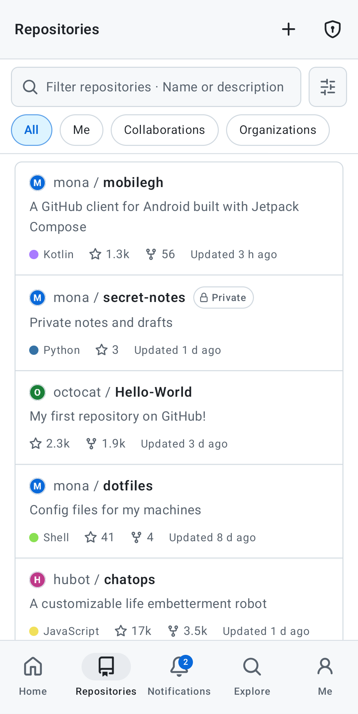<br><sub>Repositories: compact filter bar, private badge</sub></td>
    <td align="center">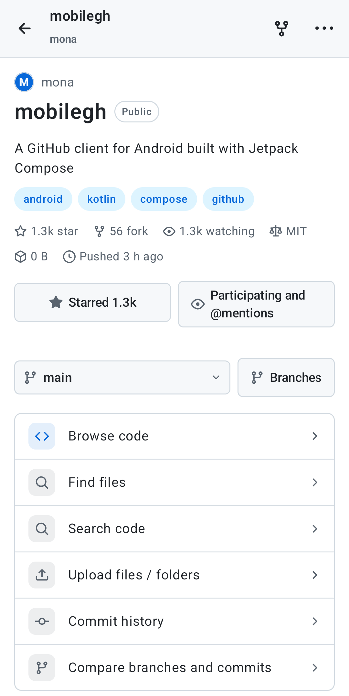<br><sub>Repository: code entry points + icon grid</sub></td>
    <td align="center">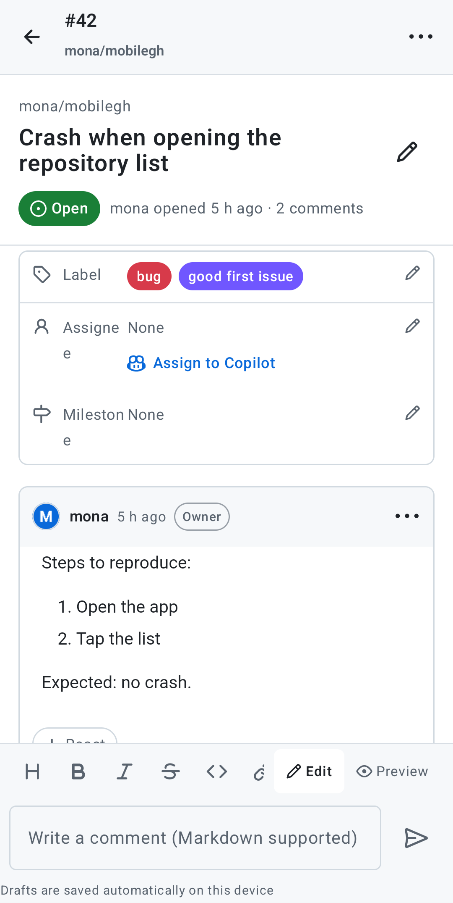<br><sub>Issue thread</sub></td>
  </tr>
  <tr>
    <td align="center">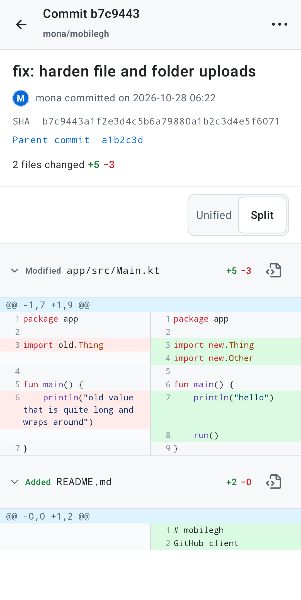<br><sub>Commit: side-by-side diff</sub></td>
    <td align="center">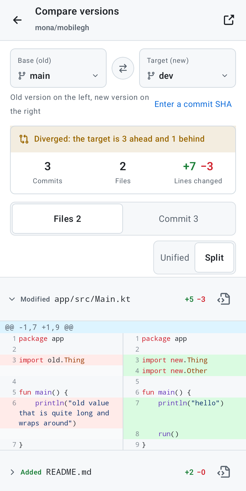<br><sub>Compare: summary card, files / commits tabs</sub></td>
    <td align="center">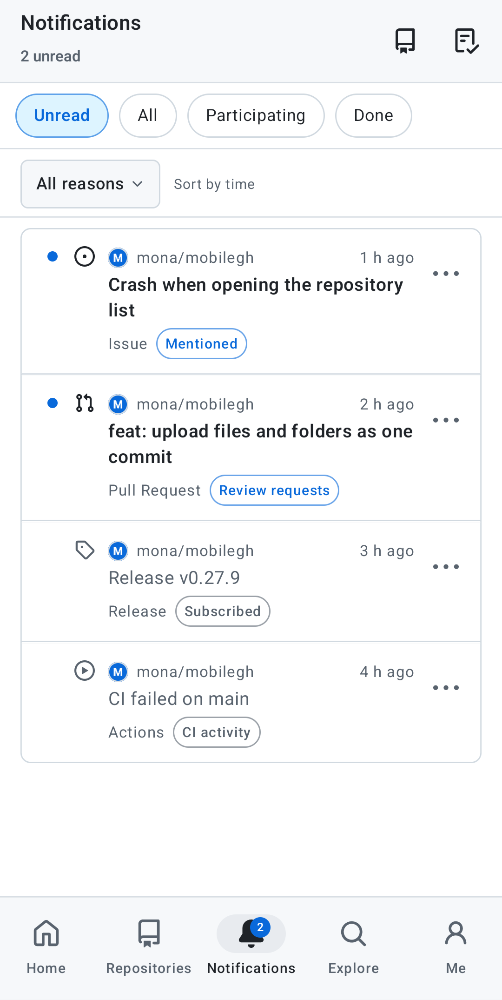<br><sub>Notifications: unread, grouping, bulk actions</sub></td>
    <td align="center">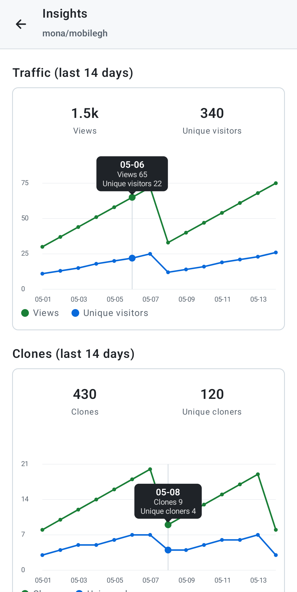<br><sub>Insights: tap a chart to read its values</sub></td>
  </tr>
  <tr>
    <td align="center">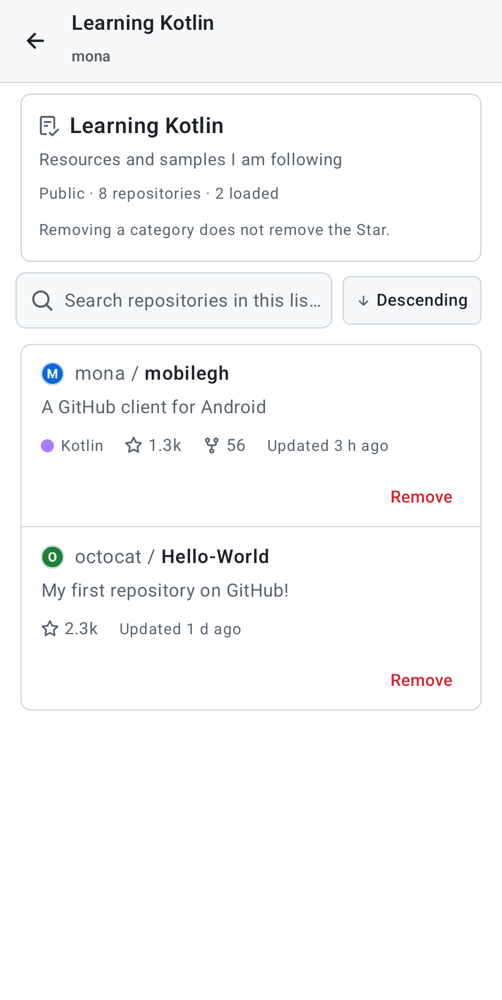<br><sub>Star list detail</sub></td>
    <td align="center">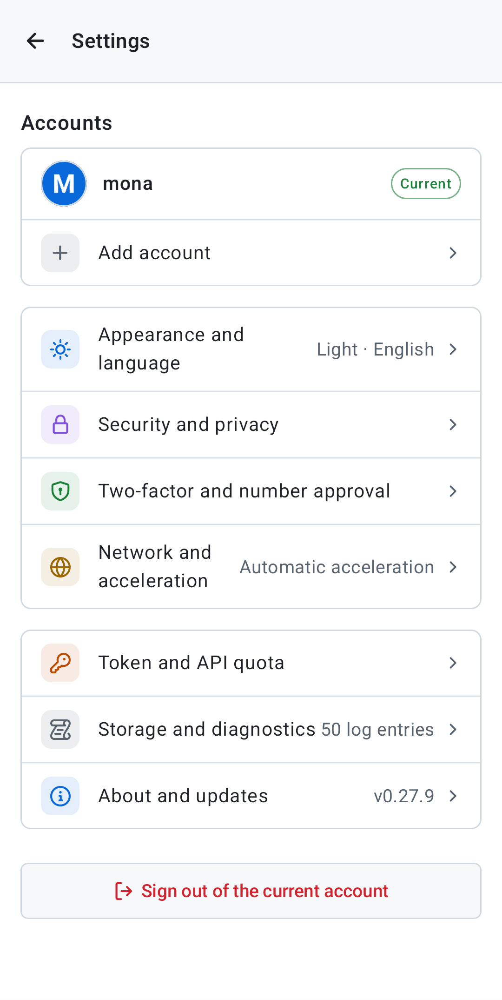<br><sub>Settings: organized by category</sub></td>
    <td align="center">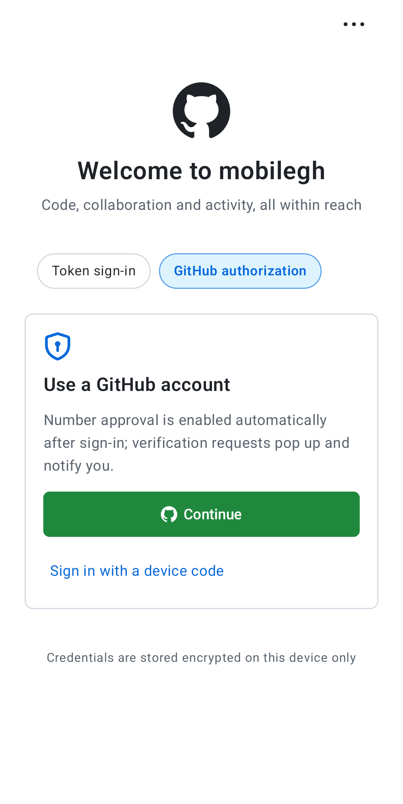<br><sub>Sign-in: a clean entry, maintenance moved to the top right</sub></td>
    <td align="center">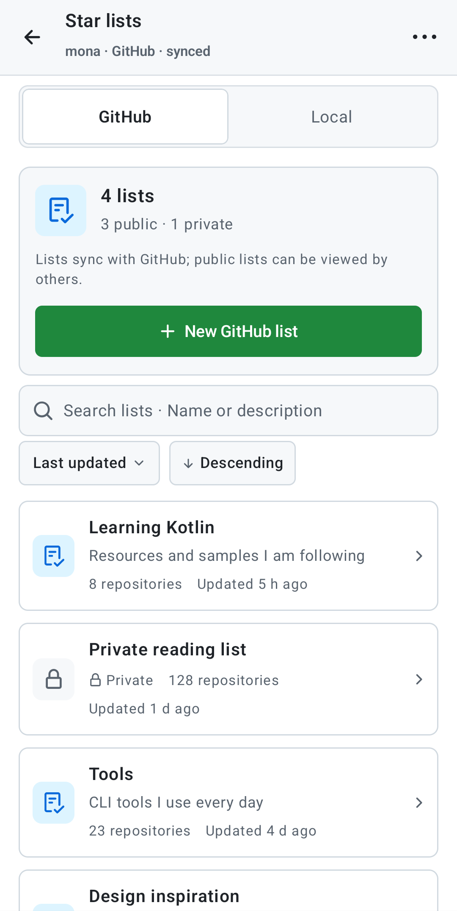<br><sub>Star lists: summary card, search and sort</sub></td>
  </tr>
</table>

## Features

### Sign-in and security

- **GitHub sign-in with automatic number approval**: GitHub authorization in the system browser (PKCE) is the default. After it returns, this device is registered automatically as an approval device, a Keystore key is generated and listening starts. Token sign-in and device-code sign-in remain available. On first launch the app asks for notification and background permissions; both can be managed or turned off in Settings
- **Native number approval**: when a request arrives, a number-confirmation dialog pops up on any page and a system notification is sent in the background; tapping it opens the same approval flow. Verified authenticated push is preferred in the background, with polling and reconnection as a fallback; the private key lives in the Android Keystore. No device file import, no official app and no desktop script are needed. [Configuration and verification notes](docs/MOBILE2FA_NATIVE_IMPORT.md) (Chinese)
- **Built-in TOTP authenticator**: scan GitHub's two-factor QR code (decoded locally with CameraX + ZXing, no image is uploaded) or paste a secret / otpauth link; shows the six-digit code with a countdown and copy action, supports multiple accounts, secrets are encrypted with the Keystore. Standard RFC 6238; this is not the same as GitHub Mobile's number matching
- **Long-lived sign-in**: OAuth does not request `offline_access`, the validity is whatever GitHub actually issues; when device authorization returns a refresh credential it is stored encrypted and used once on a 401. Settings → Security and privacy can reauthorize
- **App lock**: fingerprint / face / screen lock on launch or after being away for a while; the home screen widget can hide notification details
- **A clean sign-in page**: the top-right "More" holds update check, detailed logs, network connection, authenticator and help

### Browsing and reading

- **Repositories**: rendered README (including relative-path images), syntax highlighting, Markdown / image preview, branch and tag switching; tap an image to zoom, save or share
- **Code reading**: file-name / path finder in a repository, in-repository and global code search, line-by-line blame, jump to a line or commit
- **Diffs**: commits, branch / tag / SHA comparison and PR file changes all offer "Unified / Split" views; split is old-left / new-right with changed lines aligned side by side. Files are collapsed by default, and a notice appears when GitHub's compare API hits its 300-file limit
- **Contributors**: cumulative commits, time ranges, whole-week trends, lines added / deleted, share, active weeks; on the weekly bar chart, tap or drag to see the value above the bar, with previous / next week buttons below
- **Chart readouts**: commit activity, weekday distribution and traffic line charts all show a bubble with the value and date when you tap, long-press or drag
- **Public achievements, contribution heatmap, profile editing, organizations and their activity, Gists, Releases, Projects boards**
- **GitHub-style lists**: private repositories everywhere show the same gray outlined "Private" badge with a lock; Star lists, user rows and commit rows follow GitHub's layout

### Issues and pull requests

- Lists, threads, comments, closing, merging, reviews and file-change diffs; filters for state, author, assignee, label, milestone, review state and drafts, plus sorting and search; "My issues / PRs" are grouped by created / assigned / mentioned / review requested
- New issues read the repository's templates (including issue forms and config.yml) and can set labels, assignees and a milestone; open issues can be assigned to Copilot
- PR review: inline comments (resolved / outdated), comment on a tapped line, code suggestions, per-file "viewed" progress, check summary, requesting reviews, draft ↔ ready conversion, a merge message and branch deletion on merge
- Native Discussions: categories, answered filter, create and reply, upvote, mark answers, edit and delete
- Markdown editor: formatting toolbar with edit / preview (GitHub's official GFM rendering); drafts are encrypted and auto-saved per account and target, and kept when submission fails

### Repository writes and uploads

- Edit files online and commit to the current or a new branch (optionally opening a PR); create / delete files and branches; create, edit and delete releases with generated notes
- **Upload files / folders**: pick local files or a folder (the hierarchy is kept) and upload them as **one** commit through the full git flow; files travel over git's own transport (packfile), so they are not limited by the 40 MiB REST write limit and can reach GitHub's 100 MiB hard limit; hidden directories such as `.github` are kept, paths that differ only by case are different files, and an account switch in the middle of an upload stops it immediately
- **Git LFS**: files over 100 MiB go through LFS automatically: upload addresses are requested and the content is uploaded to LFS storage, then a pointer file is committed and the exact path is merged into `.gitattributes`. The GitHub token is only ever sent to github.com, never to the storage server; LFS's own limit is enforced at 2 GiB. A free GitHub account gets 1 GiB of LFS storage and 1 GiB of bandwidth per month
- Actions: run list, job / step details and terminal logs (error / warning filter, timestamps, word wrap, copy), manual trigger / re-run / cancel, with a form generated from the `workflow_dispatch` inputs

### Home, notifications and search

- Home: a slim profile bar, a four-column shortcut grid (show / hide and reorder them, or save an Issue / PR search as a shortcut), pinned repositories and lists, the contribution heatmap with achievements, and activity (filterable by commits / PRs / issues / releases / star-fork)
- Notifications: unread badge, swipe left to mark done (undo within 5 seconds), swipe right for read / unread, grouping by repository, filtering by reason, unsubscribe or ignore a single thread, long-press to select and process in bulk
- **Stars and lists**: the same GraphQL query as the official app searches all your Stars on the server, sorted by Star time or update time, ascending or descending; GitHub Lists are read, created, edited and deleted natively, and long-pressing Star on a repository adds it to several lists; per-account local lists are also available
- The search box takes GitHub addresses (including HTTPS / SSH clone addresses and `owner/repo`) and opens the native page; clipboard quick-open and open-from-share; search history and recently viewed repositories are kept per account on the device
- Home screen widgets: contribution graph and notification inbox

### Settings, network and diagnostics

- **Settings organized by category**: the home page has only the account and seven categories (Appearance and language, Security and privacy, Two-factor and number approval, Network and acceleration, Token and API quota, Storage and diagnostics, About and updates); each opens its own sub-page
- **Language**: Simplified Chinese / English / Follow system; takes effect immediately, Simplified Chinese by default
- **Network and acceleration**: speed-tests and picks usable acceleration nodes automatically (public content only: README images, raw source, release downloads, clone addresses; the token is never sent to acceleration nodes and private repositories always connect directly); HTTP / SOCKS5 proxy and a self-hosted API reverse proxy (advanced)
- In-app downloads: releases, source, files and Actions artifacts show progress with cancel, retry and a download history; online update picks the APK matching your device ABI from this repository's latest release
- Logs and diagnostics: filter by category, search, expand stack traces, export
- Stability: off-screen WebViews are destroyed promptly, render-process crashes are caught, image caches are cleared under memory pressure

## Architecture

MobileGH is a single-module Android app (Kotlin + Jetpack Compose, Material 3 with GitHub Primer colors, minimum Android 8.0 / API 26, about 36k lines of main code). The dependency direction is **UI → navigation and loading → data layer → network**, with no back-references.

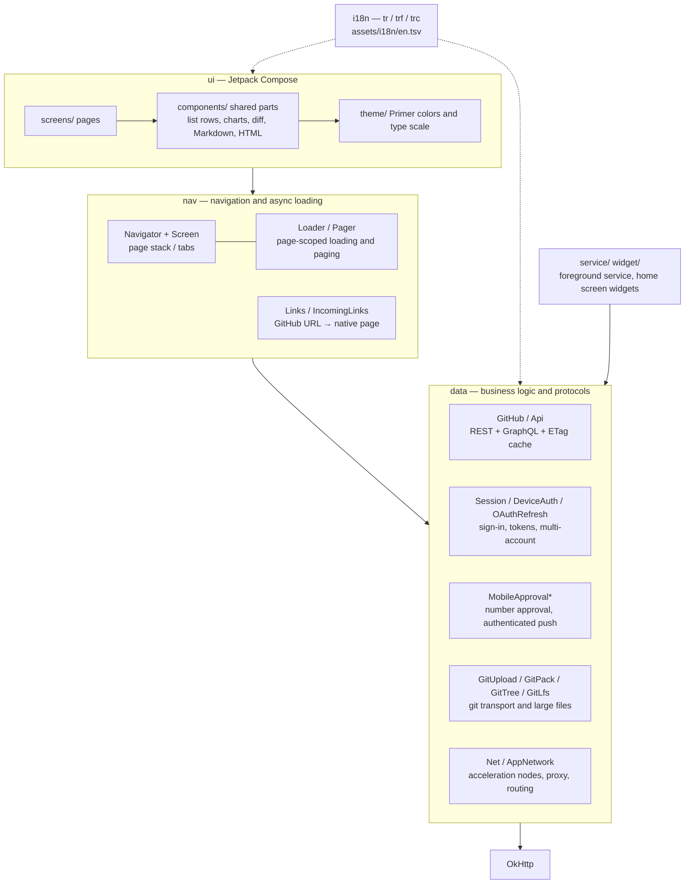

| Package | Responsibility |
| --- | --- |
| `com.mobilegh.ui.screens` | One Composable per page; layout and interaction only, data comes from `Loader` / `Pager` |
| `com.mobilegh.ui.components` | Reusable parts: list rows (`RepoItem`, `IssueItem`, ...), grouped boxes, badges, charts (with tap readouts), unified / split diff, Markdown and HTML rendering, search field, segmented control |
| `com.mobilegh.ui.theme` | GitHub Primer design tokens (light / dark), type scale and spacing |
| `com.mobilegh.nav` | `Navigator` manages the page stack and bottom tabs; `Screen` is the type-safe route; `Loader` / `Pager` are bound to the page scope, cancel requests when the page goes away and discard results after an account switch; `Links` resolves GitHub URLs to native pages |
| `com.mobilegh.data` | `Api` wraps REST / GraphQL (ETag conditional requests, unchanged content costs no quota); `Session` manages multiple accounts and tokens (encrypted with the Android Keystore); `GitUpload` + `GitPack` + `GitTree` implement smart-HTTP packfile pushes and local tree / commit building, `GitLfs` implements LFS batch uploads; `Net` / `AppNetwork` handle acceleration nodes and proxies |
| `com.mobilegh.i18n` | Chinese / English switching, see below |
| `com.mobilegh.service` / `widget` | The foreground service for number approval and Glance home screen widgets |

A few conventions apply everywhere:

- **Account isolation**: every async load records the account generation (`Session.generation`) at the time it starts, and the result is dropped if the account was switched meanwhile; multi-step writes such as uploads re-check the account before each network stage
- **Confirm before claiming**: an operation the server did not clearly confirm is not shown as successful; when the outcome is uncertain (timeout, dropped connection) the app asks you to check the branch and commit history instead of asserting "nothing changed"
- **No trust in public mirrors**: acceleration nodes only serve public content and never receive the token; git and LFS credentials only go to github.com
- **Local data**: drafts, search history and local lists are encrypted or isolated per account on the device and never uploaded

### UI language

The Chinese source text of every UI string is also the key of the English dictionary: `tr("设置")` (with variables `trf("{0} 个文件", n)`; when one Chinese word needs different English in different places, `trc("标签", "git")`). In Chinese mode the text is returned as is; in English mode the translation is looked up in `app/src/main/assets/i18n/en.tsv`, falling back to the Chinese text when there is none. The current language is Compose state, so the UI recomposes immediately after a switch.

- After adding or changing text, run `python3 tools/i18n_extract.py --check` to list entries that still lack an English translation; `--apply` wraps newly written Chinese strings in `tr(...)` in bulk
- `EnglishDictionaryTest` verifies that every translation keeps its `{0}` placeholders and `%d` format specifiers, is not empty and is not a duplicate key

## Development and testing

```bash
./gradlew :app:testDebugUnitTest          # JVM unit tests
./gradlew :app:lintDebug                  # static checks
./gradlew :app:connectedDebugAndroidTest  # device / emulator UI tests
tools/readme_screenshots.sh               # regenerate the README screenshots (needs a connected emulator or device)
```

- Tests cover git packfile and tree byte formats (checked against real git output), the LFS protocol, diff pairing for the split view, account-switch protection, the translation dictionary and more; upload-related write tests use local fake data only and never write to a real repository
- The README screenshots come from `ReadmeScreenshotsTest`: the network layer is replaced by local fake data (fictional accounts `mona` / `octocat` / `hubot`, with programmatically drawn letter avatars), and it only runs when `-e readmeShots true` is passed, so normal test runs skip it
- Technical details and the feature checklist: [docs/FEATURES.md](docs/FEATURES.md) (Chinese)

## Sign-in connection timeouts

Top-right "More" on the sign-in page → "Network connection", or Settings → Network and acceleration → "Connection proxy":

- When using a phone VPN, keep "Follow system" and include MobileGH and your sign-in browser in the VPN's per-app rules.
- When using a local proxy on the phone, choose HTTP or SOCKS5; the host is usually `127.0.0.1` and the port is whatever the proxy app shows.
- When using a computer proxy, the phone and the computer must be on the same LAN: enter the computer's LAN IP and allow LAN connections in the proxy.
- Tap "Check connection" to test the GitHub sign-in site and the API separately, then retry signing in after saving; this only checks reachability, sends no credentials and cannot replace GitHub authorization.

Public-content acceleration nodes are not sign-in proxies; never send sign-in credentials to a public mirror. The in-app proxy only covers the app's own HTTP requests; the external browser, the system download manager and the push long connection are still controlled by the system network / VPN.

## Authentication and the limits against the official app

[Authentication capabilities, APK review and organization permissions](docs/AUTH_CAPABILITIES.md) (Chinese) records the public schema and official material. GitHub Mobile's number-matching device registration and approval API is not published for third parties; passing 2FA does not grant more repository permissions. PATs, OAuth and organization SSO / policies all affect the access scope, and parity with first-party privileged apps cannot be guaranteed.

Authorization, automatic device registration, global number dialogs and background notifications can now be done inside the app. The [native configuration notes](docs/MOBILE2FA_NATIVE_IMPORT.md) (Chinese) record what was verified and the boundaries. Number approval uses a native client authorization context that can reach Mobile Auth; the [own-OAuth test](docs/MOBILE2FA_OAUTH_SCOPE_CHECK.md) (Chinese) shows the eligibility restriction for ordinary third-party Client IDs still applies, so this capability is not a registration contract GitHub publicly supports for third parties.

## Download

Get it from the [Releases](../../releases) page. Use `arm64-v8a` by default (almost all modern phones); `armeabi-v7a` for old 32-bit devices, `x86_64` for emulators / x86 devices, and `universal` if unsure.

## Build it yourself

```bash
./gradlew :app:assembleRelease
```

Release signing: copy `keystore.properties` and fill in your own key information; without it the build falls back to the debug signature.
