<div align="center">

# MobileGH

**第三方 GitHub 安卓客户端 —— 轻量、快速、符合 GitHub 设计风格，补齐官方 App 在手机上缺少的功能。**

简体中文 · [English](README.en.md)

</div>

## 为什么用它

官方 GitHub App 在手机上看不到的一些东西，MobileGH 都能看、能做：

- **贡献热力图** —— 完整的年度贡献图 + 活跃天数、单日最高、连续活跃统计，官方 App 移动端不显示热力图
- **加入的仓库** —— 包括你被邀请为协作者的仓库，不只是自己创建的
- **流量洞察** —— 仓库的访问 / 克隆统计折线图，点按或长按直接看到某一天的具体数值
- **左右分栏的代码对比** —— 提交、分支对比和 PR 的文件变更都能左旧右新并排查看，也可切回单栏
- **Actions 构建日志** —— 在手机上看 Job 日志、警告高亮，还能触发 workflow_dispatch、重跑、取消
- **大文件上传** —— 直接从手机选文件或文件夹，一次上传只产生一个提交；超过 100 MiB 的文件自动走 Git LFS
- **中英文界面** —— 设置里随时切换，默认简体中文

## 截图

截图全部使用本机虚构的测试账号（`mona`、`octocat`、`hubot`）和本地假数据生成，不包含任何真实账号信息。重新生成见[开发与测试](#开发与测试)。

<table>
  <tr>
    <td align="center">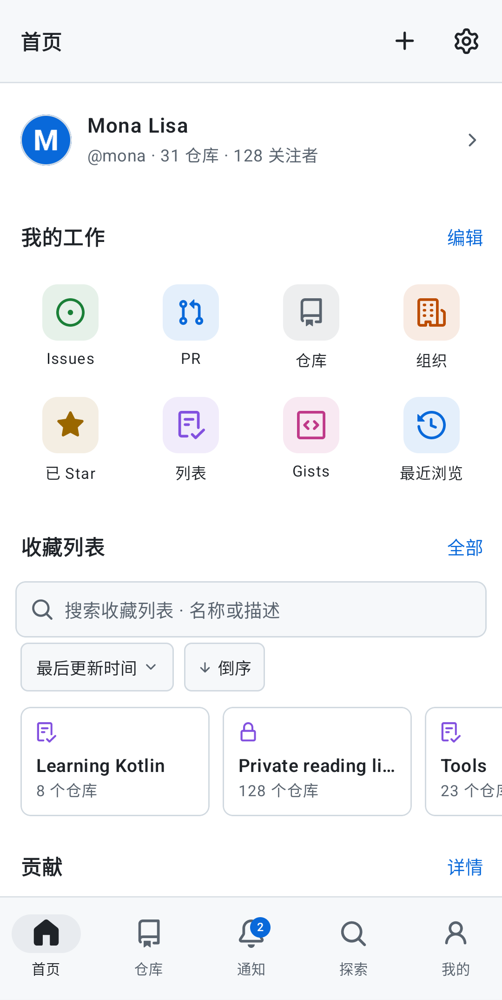<br><sub>首页：快捷入口、贡献热力图、动态</sub></td>
    <td align="center">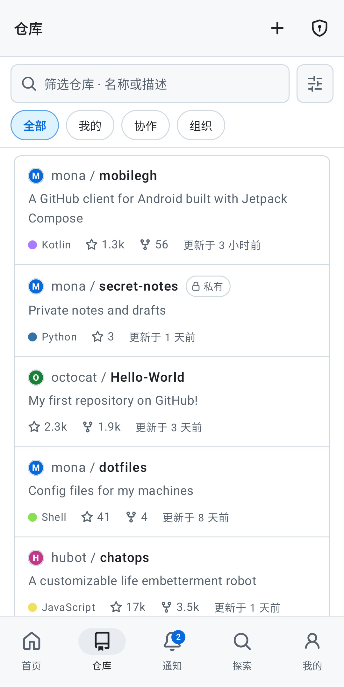<br><sub>仓库：紧凑的筛选栏与私有徽章</sub></td>
    <td align="center">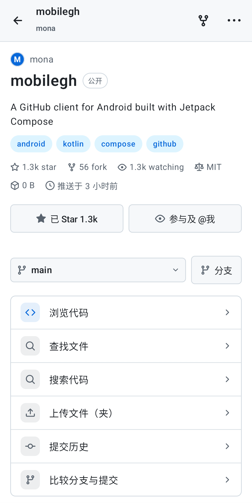<br><sub>仓库页：代码入口 + 图标网格</sub></td>
    <td align="center">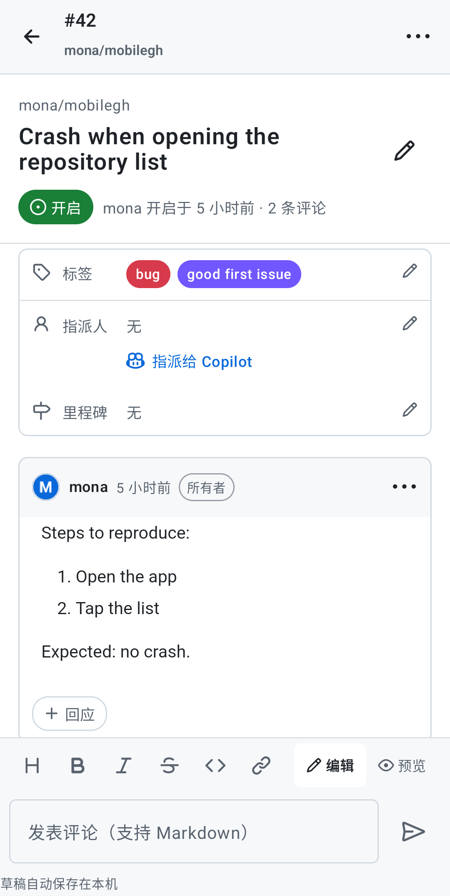<br><sub>Issue 讨论串</sub></td>
  </tr>
  <tr>
    <td align="center">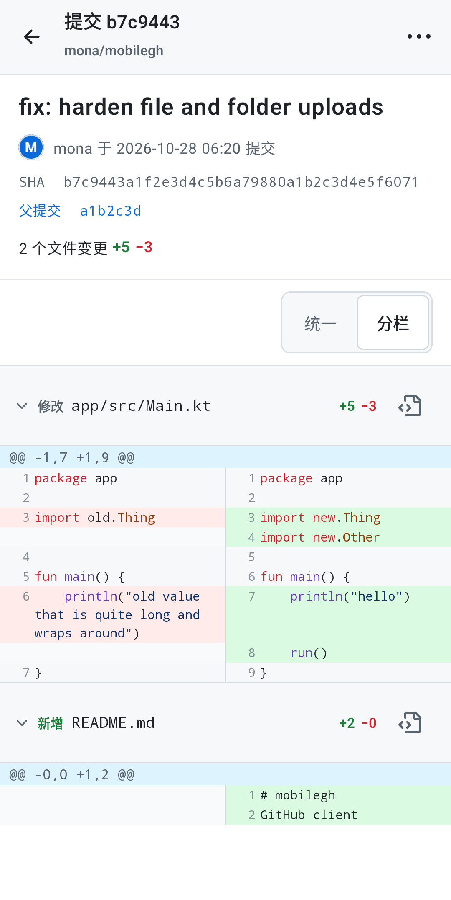<br><sub>提交详情：左右分栏对比</sub></td>
    <td align="center">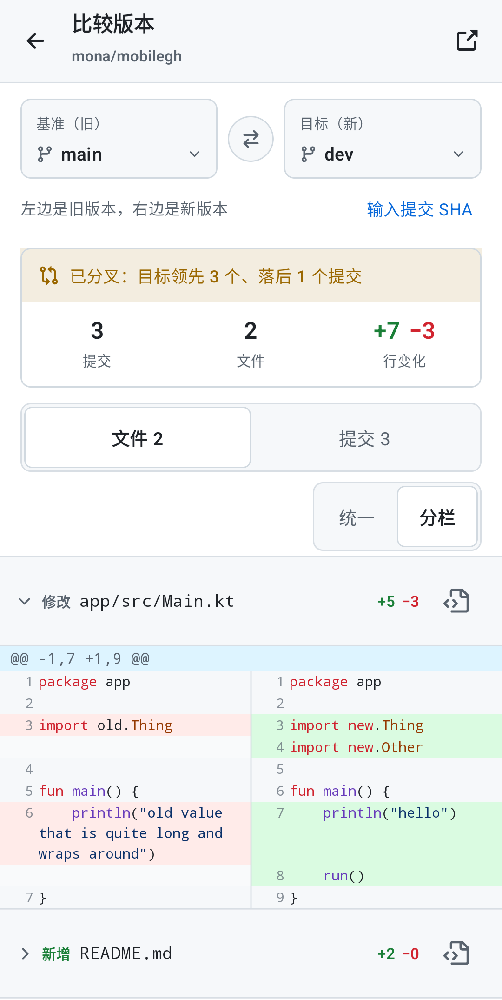<br><sub>分支对比：摘要卡与文件 / 提交页签</sub></td>
    <td align="center">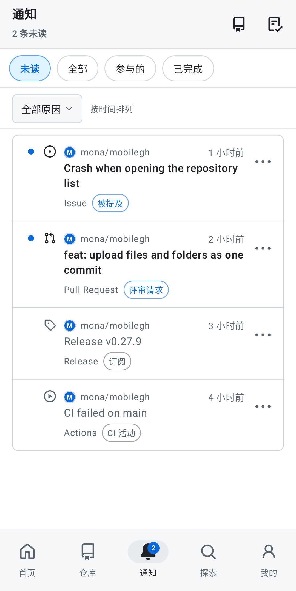<br><sub>通知：未读、分组与批量处理</sub></td>
    <td align="center">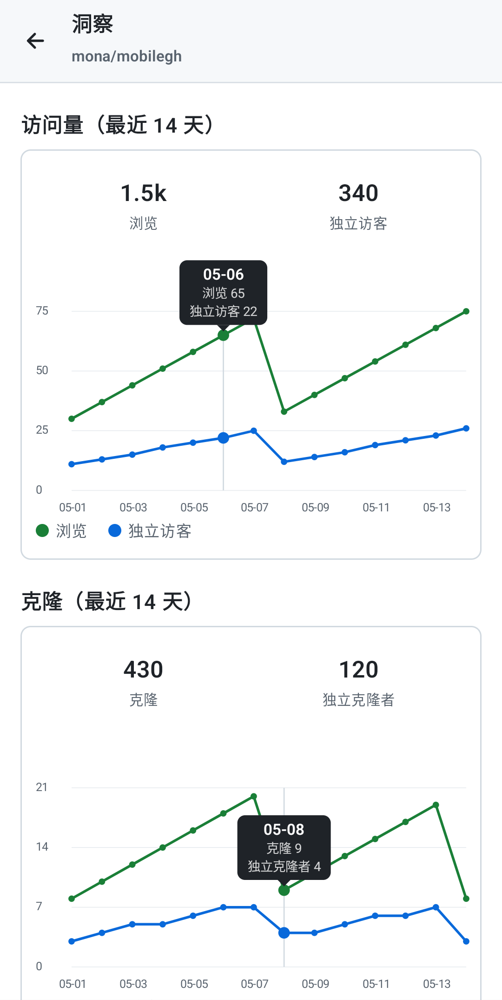<br><sub>洞察：点按图表显示具体数值</sub></td>
  </tr>
  <tr>
    <td align="center">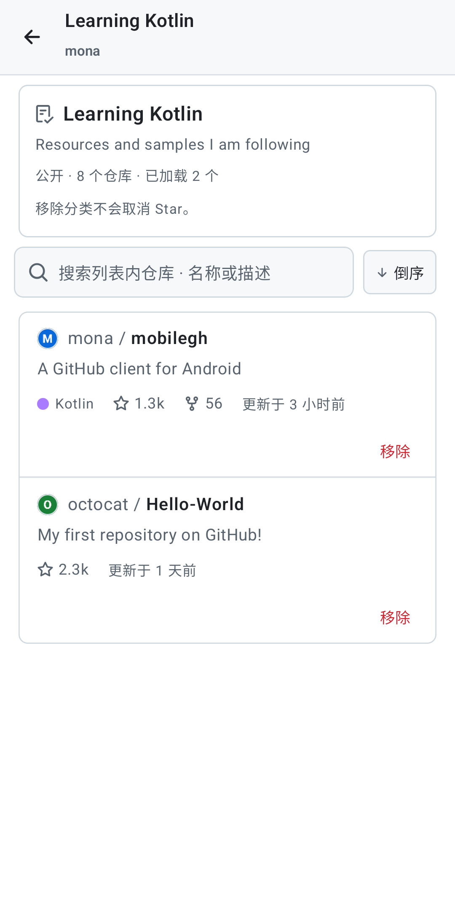<br><sub>Star 列表详情</sub></td>
    <td align="center">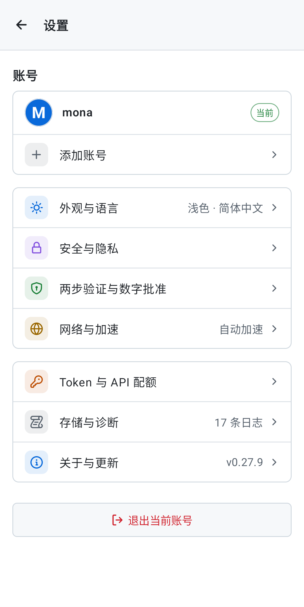<br><sub>设置：按分类整理</sub></td>
    <td align="center">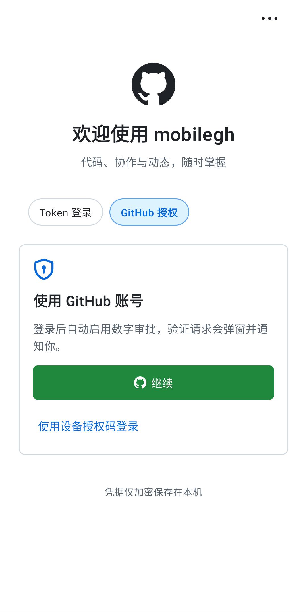<br><sub>登录：精简的入口，维护项收进右上角</sub></td>
    <td align="center">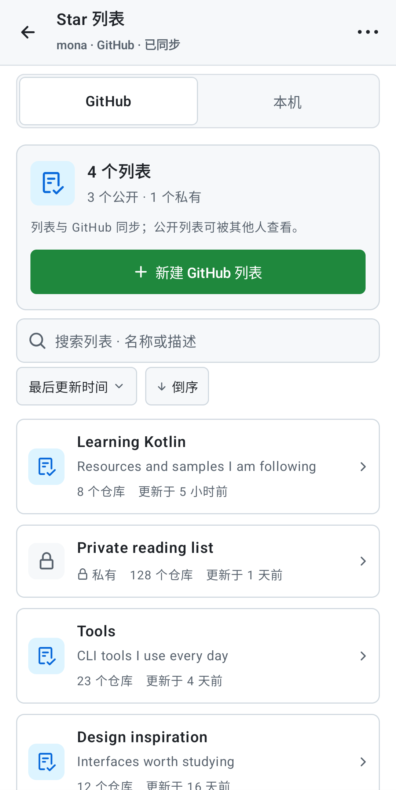<br><sub>Star 列表目录：概览卡 + 搜索排序</sub></td>
  </tr>
</table>

## 功能

### 登录与安全

- **GitHub 登录与自动数字审批**：默认使用 GitHub 授权登录（系统浏览器 + PKCE），授权返回后自动注册本机审批设备、生成 Keystore 密钥并开启监听；保留 Token 登录和设备授权码登录。首次打开申请通知与后台运行权限，设置中可管理或关闭 2FA 监听
- **原生数字批准**：收到请求时在任意页面弹出数字确认框，后台发送系统通知，点击通知进入同一批准流程。后台优先接收经过校验的认证推送，断线时通过查询补偿并重连；私钥存入 Android Keystore。不需要导入设备文件、安装官方 App 或运行桌面脚本。[配置与验证记录](docs/MOBILE2FA_NATIVE_IMPORT.md)
- **内置 TOTP 验证器**：扫码导入 GitHub 两步验证二维码（CameraX + ZXing 本地解码，画面不上传），或粘贴密钥 / otpauth 链接；查看六位码、倒计时并复制，支持多账号，密钥经 Keystore 加密。标准 RFC 6238；不等同于 GitHub Mobile 数字匹配审批
- **长期登录**：OAuth 不申请 `offline_access`，有效期以 GitHub 实际签发结果为准；设备授权返回刷新凭据时加密存储，401 时刷新并重试一次。设置 → 安全与隐私可重新授权
- **应用锁**：启动或离开一段时间后需要指纹 / 面容 / 锁屏密码；桌面小组件可隐藏通知详情
- **登录页保持干净**：右上角「更多」里集中放检查更新、详细日志、网络连接、验证器和登录帮助

### 浏览与阅读

- **仓库**：README 渲染（含相对路径图片）、代码高亮、Markdown / 图片预览、分支与标签切换；点图片可全屏缩放、保存或分享
- **代码阅读**：仓库内文件名 / 路径查找、仓库内与全站代码搜索、Blame 逐行归因、定位行号与提交跳转
- **代码对比**：提交、分支 / 标签 / SHA 对比、PR 文件变更都支持「统一 / 分栏」两种视图，分栏为左旧右新、改动行并排对齐；文件默认折叠，达到 GitHub 比较接口 300 个文件上限时会提示
- **贡献者**：累计提交、时间范围、整周趋势、新增 / 删除行、占比、活跃周；每周柱状图点按或左右拖动即可在柱子上方看到数值，下方有前后周按钮
- **图表读数**：提交活跃度、一周活跃分布、流量折线图，点按、长按或拖动都会弹出带日期的数值气泡
- **公开成就、贡献热力图、个人资料编辑、组织与组织动态、Gist、Releases、Projects 看板**
- **GitHub 风格的列表**：私有仓库统一显示灰色描边的「私有」徽章（带锁），Star 列表、用户、提交等行都按 GitHub 的版式排布

### Issues 与 Pull Requests

- 列表、讨论串、评论、关闭、合并、审查、文件变更 Diff；筛选支持状态、作者、指派人、标签、里程碑、评审状态、草稿，并可排序与搜索；「我的 Issues / PR」按创建 / 指派 / 提及 / 评审请求分类
- 新建 Issue 读取仓库模板（含 issue forms 与 config.yml），可选标签、指派人、里程碑；开放的 Issue 可指派给 Copilot
- PR 审查：行内评论（已解决 / 已过时）、点代码行发评论、代码建议、文件「已查看」进度、检查状态汇总、请求审查、草稿与可评审互转、合并时填写说明并删除分支
- 原生 Discussions：分类、已回答筛选、创建与回复、点赞、采纳答案、编辑与删除
- Markdown 编辑器：格式工具栏 + 编辑 / 预览（GitHub 官方 GFM 渲染）；草稿按账号与目标加密自动保存，提交失败保留

### 仓库写入与上传

- 在线编辑文件并提交到当前分支或新分支（可直接发起 PR），新建 / 删除文件、分支，新建、编辑、删除 Release 并自动生成说明
- **上传文件（夹）**：多选本机文件或选文件夹，递归带上层级，一次上传按完整 git 流程写成**一个**提交再推到分支；文件走 git 自己的传输（packfile），不受 REST 写接口 40 MiB 限制，可达 GitHub 的 100 MiB 硬上限；隐藏目录（如 `.github`）会保留、大小写不同的路径视为不同文件；账号在上传中途被切换会立即停止
- **Git LFS**：超过 100 MiB 的文件自动走 LFS——先申请上传地址并上传到 LFS 存储，仓库里提交指针文件并自动并入 `.gitattributes`（只写该文件的精确路径）；GitHub 令牌只发给 github.com，不会发到存储服务器；LFS 自身上限按 2 GiB 拦截。GitHub 免费账号的 LFS 额度为 1 GiB 存储和每月 1 GiB 流量
- Actions：运行列表、Job / Step 明细与终端日志（错误 / 警告筛选、时间戳、自动换行、复制）、手动触发 / 重跑 / 取消，手动运行按 `workflow_dispatch` 参数生成表单

### 首页、通知与搜索

- 首页：精简个人信息条、四列快捷入口（可编辑显示与顺序、可保存 Issue / PR 搜索为快捷方式）、收藏仓库、收藏列表、贡献热力图与成就、动态（按提交 / PR / Issue / 发布 / Star-Fork 分类）
- 通知：未读角标，左滑完成（5 秒内可撤销）、右滑已读 / 未读，按仓库分组、按原因筛选，单条取消订阅或忽略，长按多选批量处理
- **Star 与列表**：与官方 App 相同的 GraphQL 查询在服务端搜索全部 Star，可按 Star 时间或更新时间排序、切换正序 / 倒序；原生读取、新建、编辑、删除 GitHub Lists，仓库页长按 Star 可加入多个列表；也提供按账号保存在本机的本机列表
- 搜索框可直接粘贴 GitHub 地址（含 HTTPS / SSH 克隆地址、`owner/repo`）打开对应原生页面；剪贴板快捷打开、系统分享打开；搜索历史与最近浏览按账号保存在本机
- 桌面小组件：贡献图、通知收件箱

### 设置、网络与诊断

- **设置按分类整理**：首页只有账号和七个分类入口（外观与语言、安全与隐私、两步验证与数字批准、网络与加速、Token 与 API 配额、存储与诊断、关于与更新），每个分类进入自己的子页
- **界面语言**：简体中文 / English / 跟随系统，切换后立即生效，默认简体中文
- **网络与加速**：自动测速并选择可用的加速节点（仅用于公开内容：README 图片、源码、Release 下载、克隆地址；Token 不会发给加速节点，私有仓库始终直连）；可配置 HTTP / SOCKS5 代理、自建 API 反向代理（高级）
- 应用内下载：Release 资源、源码、文件、Actions 产物都有进度框、取消、重试和下载记录；在线更新从本仓库最新 Release 选择匹配设备架构的 APK
- 日志与诊断：按分类筛选、搜索、展开堆栈、导出
- 稳定性：及时销毁离屏 WebView、捕获渲染进程崩溃、内存不足时清理图片缓存

## 架构

MobileGH 是单模块 Android 应用（Kotlin + Jetpack Compose，Material 3 配 GitHub Primer 配色，最低 Android 8.0 / API 26，约 3.6 万行主代码）。依赖方向是 **界面 → 导航与加载 → 数据层 → 网络**，没有反向依赖。

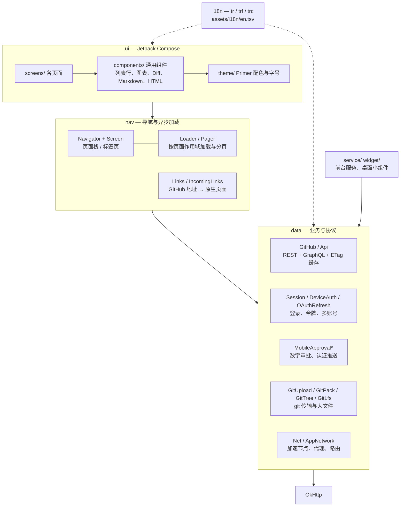

| 包 | 职责 |
| --- | --- |
| `com.mobilegh.ui.screens` | 每个页面一个 Composable，只负责布局与交互，数据通过 `Loader` / `Pager` 获得 |
| `com.mobilegh.ui.components` | 可复用组件：列表行（`RepoItem`、`IssueItem` 等）、分组框、徽章、图表（含点按读数）、统一 / 分栏 Diff、Markdown 与 HTML 渲染、搜索栏、分段选择器 |
| `com.mobilegh.ui.theme` | GitHub Primer 设计令牌（浅色 / 深色）、字号与间距 |
| `com.mobilegh.nav` | `Navigator` 管理页面栈与底部标签；`Screen` 是类型安全的路由；`Loader` / `Pager` 绑定页面作用域，页面销毁时取消请求、账号切换后丢弃旧结果；`Links` 把 GitHub 网址解析为原生页面 |
| `com.mobilegh.data` | `Api` 封装 REST / GraphQL（ETag 条件请求，不变的内容不消耗配额）；`Session` 管理多账号与令牌（Android Keystore 加密）；`GitUpload` + `GitPack` + `GitTree` 实现 smart HTTP 的 packfile 推送与本地建树 / 建提交，`GitLfs` 实现 LFS 批量接口上传；`Net` / `AppNetwork` 负责加速节点与代理 |
| `com.mobilegh.i18n` | 中英文切换，见下文 |
| `com.mobilegh.service` / `widget` | 数字审批的前台服务与 Glance 桌面小组件 |

几条贯穿全局的约定：

- **账号隔离**：每次异步加载记录发起时的账号代次（`Session.generation`），账号切换后旧请求的结果直接丢弃；上传这类多步写入在每个网络阶段前再次核对账号
- **写入先确认后宣称**：服务端没有明确确认的操作不显示成功；结果不确定（超时、断线）时提示先查看分支和提交历史，而不是断言「没有更新」
- **不信任公开镜像**：加速节点只用于公开内容，令牌不会发给加速节点；git 与 LFS 的凭据只发给 github.com
- **本地数据**：草稿、搜索历史、本机列表按账号加密或隔离保存在本机，不上传

### 界面语言

界面文案的源码原文就是中文，同时是英文词典的键：`tr("设置")`（带变量用 `trf("{0} 个文件", n)`，同一个中文词在不同位置译法不同时用 `trc("标签", "git")`）。中文模式原样返回，英文模式从 `app/src/main/assets/i18n/en.tsv` 查译文，查不到就退回中文。当前语言是 Compose 状态，切换后界面立即重组刷新。

- 新增或修改文案后运行 `python3 tools/i18n_extract.py --check`，会列出缺少英文译文的条目；`--apply` 可把新写的中文字符串批量包装成 `tr(...)`
- `EnglishDictionaryTest` 会检查词典里每条译文都保留了 `{0}` 占位符和 `%d` 格式符、没有空译文、没有重复键

## 开发与测试

```bash
./gradlew :app:testDebugUnitTest          # JVM 单元测试
./gradlew :app:lintDebug                  # 静态检查
./gradlew :app:connectedDebugAndroidTest  # 设备 / 模拟器 UI 测试
tools/readme_screenshots.sh               # 重新生成 README 截图（需要一台已连接的模拟器或设备）
```

- 测试覆盖 git packfile 与 tree 字节格式（对照真实 git 的输出）、LFS 协议、diff 分栏配对、账号切换保护、翻译词典等；上传相关的写入测试只用本地假数据，不会写真实仓库
- README 截图由 `ReadmeScreenshotsTest` 生成：网络层被替换为本地假数据（虚构账号 `mona` / `octocat` / `hubot`，头像是程序画的字母头像），只在传入 `-e readmeShots true` 时运行，平常跑测试会跳过
- 技术细节与功能核对表：[docs/FEATURES.md](docs/FEATURES.md)

## 登录连接超时

登录页右上角「更多」→「网络连接」，或设置 → 网络与加速 →「连接代理」：

- 使用手机 VPN 时保留「跟随系统」，在 VPN 的分应用规则中包含 MobileGH 和登录浏览器。
- 使用手机本地代理时，选择 HTTP 或 SOCKS5，主机通常为 `127.0.0.1`，端口以代理软件实际显示为准。
- 使用电脑代理时，手机与电脑需在同一局域网，填写电脑的局域网 IP，并在电脑代理中允许局域网连接。
- 点「检查连接」分别检查 GitHub 登录站点和 API，保存后重新尝试登录；这里只检查网络可达性，不发送登录凭据，也不能代替 GitHub 授权。

公开内容加速节点不是登录代理；不要把登录凭据发给公开镜像。App 内代理只覆盖自身的 HTTP 请求，外部浏览器、系统下载器与推送长连接仍由系统网络 / VPN 控制。

## 认证与官方 App 的功能边界

[认证能力、APK 核对与组织权限说明](docs/AUTH_CAPABILITIES.md)记录了公开 schema 与官方资料。GitHub Mobile 的数字匹配设备注册及批准 API 未公开供第三方使用；通过 2FA 不会增加仓库权限。PAT、OAuth 和组织 SSO / 策略均影响访问范围，不能保证与第一方特权应用相同。

现在可在 App 内完成授权、自动设备注册、全局数字弹窗及后台通知。[原生配置说明](docs/MOBILE2FA_NATIVE_IMPORT.md)记录实际验证和边界。数字审批使用能够访问 Mobile Auth 的原生客户端授权上下文；[自有 OAuth 实测](docs/MOBILE2FA_OAUTH_SCOPE_CHECK.md)中的普通第三方 Client ID 接口资格限制仍存在，该能力不是 GitHub 已公开支持的第三方注册契约。

## 下载

去 [Releases](../../releases) 页面下载。默认装 `arm64-v8a`（绝大多数现代手机）；老 32 位设备用 `armeabi-v7a`，模拟器 / x86 设备用 `x86_64`，不确定就用 `universal`。

## 自行构建

```bash
./gradlew :app:assembleRelease
```

发布签名：复制 `keystore.properties` 并填入自己的密钥信息即可；未配置时自动回退到 debug 签名。
